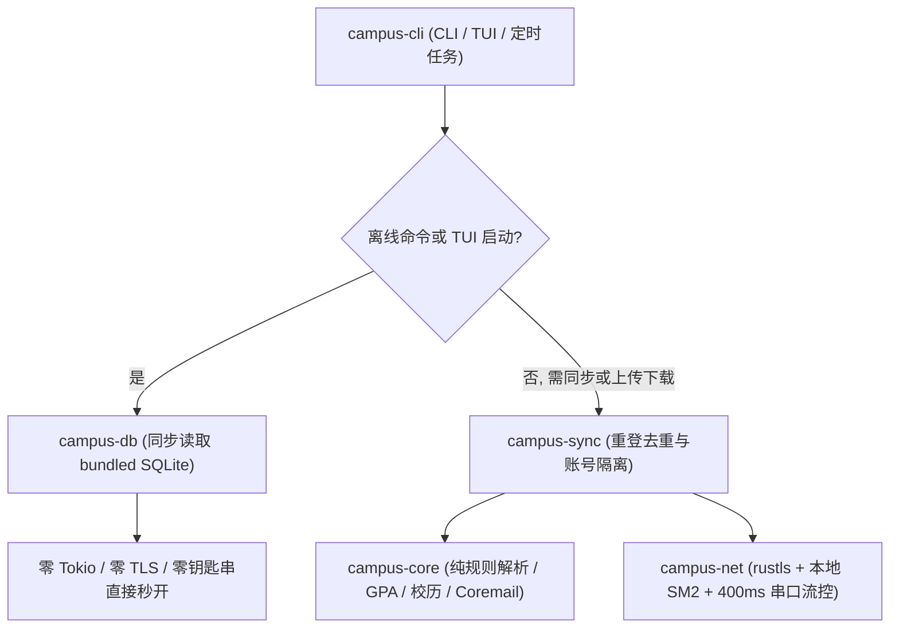
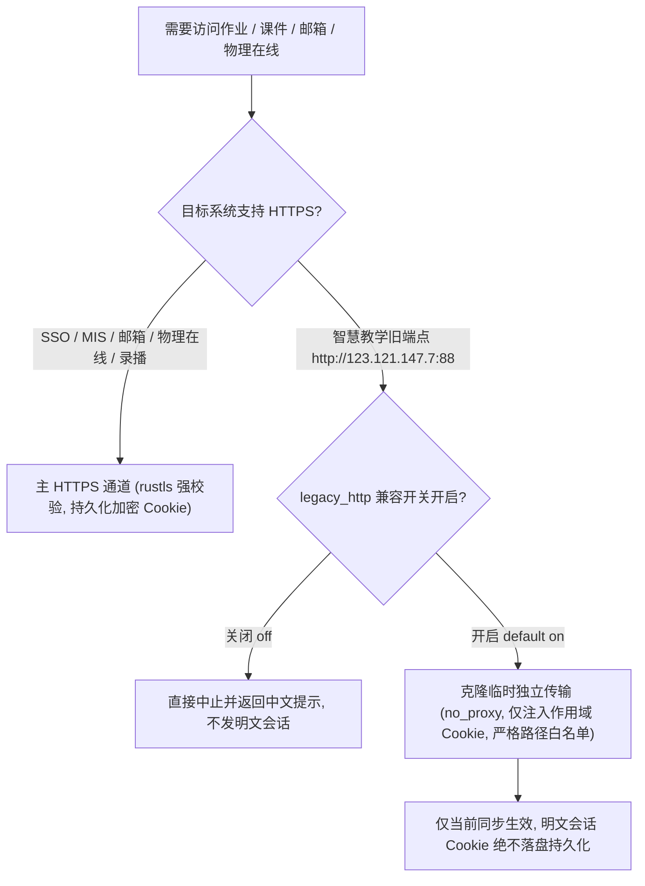

<p align="center">
  
</p>

<h1 align="center">BJTUselfService-Lite · 交大自由行轻量版</h1>

<p align="center"><strong>Version 1.0.1 (`campus`)</strong></p>

<p align="center">
  <em>面向北京交通大学学生的纯 Rust 跨平台校园服务终端与全屏工作台 —— 零运行时依赖、单文件绿色便携（Linux 静态二进制 &lt; 10 MiB）、毫秒级本地秒开。如对你有帮助，欢迎点亮 Star；二次分发与修改请遵守下方署名与协议要求。</em>
</p>

<p align="center">
  <a href="https://github.com/Tak1naa/BJTUselfService-Lite/releases"></a>
  <a href="https://github.com/Tak1naa/BJTUselfService-Lite/stargazers"></a>
  <a href="./LICENSE"></a>
  <a href="https://github.com/Tak1naa/BJTUselfService-Lite/actions/workflows/linux-rust.yml"></a>
  <br>
  
  
  
</p>

---

## 作者说明

本项目是北京交通大学校园自助服务客户端的 **Rust 原生轻量化重构分支**（`BJTUselfService-Lite`），面向只需要高效查课、追作业、收邮件、下课件与脚本自动化的同学，彻底去掉 JVM、Electron 与重型 GUI 外壳，做到**单文件拷走即用、离线毫秒级启动、零外置数据库或 TLS 共享库依赖**。

原 Kotlin Multiplatform 图形端历史源码已完整冻结并保存在只读标签 `archive/kmp-upstream` 中；从 `1.0.0` 首个正式版起，主分支 `main` 专精维护 `linux/` 下的五层 Rust CLI / TUI 客户端（命令行名保持简短的 `campus`）。

本项目为非营利开源软件，全部登录、SM2 密码加密与缓存均**在用户本地设备完成**，请求直连北京交通大学官方服务接口，不经过任何第三方中转服务器。请勿将本仓库二进制或源码包装售卖或隐去上游与本仓库署名。

---

## 目录

- [作者说明](#作者说明)
- [这是什么](#这是什么)
- [版权、许可证与署名要求](#版权许可证与署名要求)
- [支持平台与安装包形态](#支持平台与安装包形态)
- [普通用户安装教程](#普通用户安装教程)
- [界面预览与工作台快捷键](#界面预览与工作台快捷键)
- [日常高频命令](#日常高频命令)
- [工作原理与架构隔离](#工作原理与架构隔离)
- [安全、隐私与合规声明](#安全隐私与合规声明)
- [从源码构建与本地检查](#从源码构建与本地检查)
- [致谢](#致谢)

---

## 这是什么

**BJTUselfService-Lite (`campus`)** 是一套采用 Rust + bundled SQLite + `rustls` 从底层重构的跨平台终端与全屏 TUI 客户端。它把「离线读取/渲染」与「联网认证/同步」彻底拆开：打开工作台或离线查询时**不启动 Tokio 异步运行时、TLS 网络栈与系统钥匙串**，直接同步读取本地加密缓存；联网同步时则通过独立的串行限速、重登去重与重定向白名单保护账号会话。

| 模块 / 能力 | 说明 |
| --- | --- |
| **全屏工作台 (TUI)** | 直接运行 `campus` 进入 10 个功能标签页，毫秒级秒开本地缓存，按 `r` 后台同步不卡界面 |
| **作业列表、下载与提交** | 未提交作业自动置顶排序、逾期弱化提示；按 `d` 下载老师/已交附件，按 `u` 拖入多文件提交 |
| **校内邮箱代收 (Coremail)** | TUI 第 6 页直接查看收件箱未读状态、发件人与正文；`campus mail` / `d` 键一键下载邮件附件 |
| **课表与系统日历导出** | 查看当日课表与校区错峰时间、周历网格切换（`v`），支持 `campus export ics` 导入手机日历 |
| **成绩查询与 GPA 试算** | 自动计算学分加权均分与 4.0 制 GPA，支持按学期和课程性质筛选、自选试算与 CSV 导出 |
| **五色教室占用与实时人数** | 按教学楼（`b`/`B`）与周次（`+`/`-`）查看五色周占用网格，支持空闲教室与实时人数估计查询 |
| **课件下载与录播合成** | 一键下载已开放的课程资料与录播视频（4 MiB 分片断点续传，不内置第三方重型播放器） |
| **物理在线 (`PhyVlab`)** | 独立账号隔离存储，支持在「物理在线」页按 `l` 直连登录与点选验证码、草稿上传增删与最终提交 |
| **统一默认下载路径** | 作业附件、邮箱附件与课件未指定 `-o` 时均默认保存至系统原生「下载」文件夹并自动避让重名 |
| **定时自动同步与自更新** | 支持注册 `systemd --user` / `launchd` 后台同步与变更通知；支持每 24 小时检查更新与 `SHA256` 校验替换 |

---

## 版权、许可证与署名要求

本项目依据 [MIT License](./LICENSE) 开源（保留原始版权 `Copyright (c) 2024 BJTUselfService`，并包含重构版权 `Copyright (c) 2026 Tak1naa`）。

- **允许自由使用、学习、修改与衍生**，前提是在所有副本或实质性衍生作品中完整保留 `LICENSE` 声明与版权信息。
- **二次开发或分发必须明确标明出处**：请保留上游开源先驱致谢以及本仓库 [Tak1naa/BJTUselfService-Lite](https://github.com/Tak1naa/BJTUselfService-Lite) 的署名说明。
- **反对商业倒卖与去源打包**：不得将免费发布的原始构建或略作换皮的衍生包用于收费售卖或冒充原创发布。

---

## 支持平台与安装包形态

所有发布产物均由 GitHub Actions 自动构建并附带 **`SHA256SUMS.txt`** 校验文件及 **SLSA Build Provenance** 构建溯源证明：

| 平台 | 发布文件示例（`1.0.1`） | 压缩 / 安装说明 | 二进制特性 |
| --- | --- | --- | --- |
| **Windows 10 / 11 (x64)** | `campus-bjtu-1.0.1-windows-x64.zip` | 绿色压缩包约 `3.5 MiB`，内含 `campus.exe`、专属图标与一键解除拦截脚本 `campus.ps1` | 原生 Win32，零 VC++/JVM 运行时 |
| **macOS (Universal / arm64 / x64)** | `campus-bjtu-1.0.1-macos-universal.tar.gz` | Universal 双架构归档约 `6.6 MiB`；默认启用 ad-hoc `codesign` | 原生 Mach-O，零外部运行时 |
| **Linux (`.deb`)** | `campus-bjtu_1.0.1_amd64.deb` | 适用于 Ubuntu / Debian / Mint，自动安装命令补全与 `man` 手册 | `x86_64-unknown-linux-musl` 纯静态二进制（`< 10 MiB`） |
| **Linux (`.rpm`)** | `campus-bjtu-1.0.1-1.x86_64.rpm` | 适用于 Fedora / RHEL / AlmaLinux，自动安装补全与手册 | `x86_64-unknown-linux-musl` 纯静态二进制（`< 10 MiB`） |
| **通用 Linux / WSL** | `campus-bjtu-1.0.1-linux-x86_64.tar.gz` | 便携压缩包约 `4.0 MiB`，解压单文件即可运行 | `static-pie linked`，不依赖 `glibc` / `openssl` / `libdbus` |

---

## 普通用户安装教程

前往 **[Releases 下载页面](https://github.com/Tak1naa/BJTUselfService-Lite/releases)** 下载对应系统的安装包，并可结合同目录的 `SHA256SUMS.txt` 核验完整性：

### 1. Windows 10 / 11

1. 下载 **`campus-bjtu-1.0.1-windows-x64.zip`** 并解压到固定文件夹（例如 `D:\Tools\campus`）。
2. **直接双击 `campus.exe`**（若弹出「Windows 已保护你的电脑」，点击 **「更多信息」 -> 「仍要运行」**；也可右键使用 PowerShell 运行随附的 `campus.ps1` 自动执行 `Unblock-File` 解除系统下载拦截并启动）。
3. 首次打开会自动弹出登录向导：输入学号和 MIS 密码（密码输入时不显示字符属正常保护） -> 选择 **`Y`** 自动在桌面创建「交大自由行 CLI」快捷方式 -> **自动同步所有页面数据**并进入全屏工作台。以后双击桌面快捷方式即可秒开。

### 2. macOS（Apple Silicon M 系列 / Intel）

1. 下载 **`campus-bjtu-1.0.1-macos-universal.tar.gz`** 并解压，在终端运行：
   ```sh
   tar -xzf campus-bjtu-1.0.1-macos-universal.tar.gz
   xattr -d com.apple.quarantine ./campus
   sudo install -m 755 ./campus /usr/local/bin/campus
   campus
   ```
2. 首次保存或读取凭据时，在钥匙串授权弹窗点击 **「始终允许」** 即可。

### 3. Linux（Ubuntu / Debian / Fedora / 通用发行版）

- **Ubuntu / Debian / Linux Mint**：`sudo apt install ./campus-bjtu_1.0.1_amd64.deb`
- **Fedora / RHEL / AlmaLinux**：`sudo dnf install ./campus-bjtu-1.0.1-1.*.x86_64.rpm`
- **任意 Linux / WSL**：
  ```sh
  tar -xzf campus-bjtu-1.0.1-linux-x86_64.tar.gz
  install -Dm755 ./campus ~/.local/bin/campus
  campus
  ```
- **纯 SSH / 无桌面环境**：如果当前终端没有 GNOME Keyring / KWallet 等桌面钥匙串服务，首次登录前先执行：
  ```sh
  campus config set vault.backend file
  ```

<details>
<summary><strong>进阶排查、数据清理与自卸载说明（点击展开）</strong></summary>

- **更新已有安装**：
  - 便携解压版直接运行 `campus update --yes`（或进入 TUI 按 `U`），程序会从 GitHub Releases 核验 `SHA256SUMS.txt` 后原子替换可执行文件。
  - `.deb` / `.rpm` 包用户执行 `campus update` 会自动拉取新版安装包到缓存目录并提示对应的 `sudo apt install` / `sudo dnf install` 升级命令。
  - 如不希望启动时后台检查更新，可执行 `campus config set update.check off`。
- **完整注销与彻底删除本地数据**：
  ```sh
  campus auth logout --forget      # 撤销并清除 MIS 凭据与会话
  campus phyvlab logout --forget   # 撤销并清除物理在线独立凭据与会话
  campus cache clear --yes         # 清除全部本地缓存数据
  ```
- **数据目录位置**：
  - Linux / macOS：`~/.local/share/campus-portal`、`~/.config/campus-portal`、`~/.cache/campus-portal`
  - Windows：`%LOCALAPPDATA%\campus-portal`
- **物理在线无浏览器登录**：在纯命令行 / SSH 环境下运行 `campus phyvlab login --no-browser`，复制终端打印的本地或验证地址在任意浏览器完成后回填即可。

</details>

---

## 界面预览与工作台快捷键

<p align="center">
  
</p>

直接运行 `campus`（或离线模式 `campus tui --offline`）进入全屏工作台，共 10 个核心标签页（`1` 课表 / `2` 作业 / `3` 成绩 / `4` 考试 / `5` 教室 / `6` 邮箱 / `7` 学年历 / `8` 课件 / `9` 同步 / `0` 物理在线）：

| 按键 | 作用 |
| --- | --- |
| `1`-`0` / `Tab` / `<-` `->` | 切换 10 个功能标签页（课表、作业、成绩、考试、教室、邮箱、学年历、课件、同步、物理在线） |
| `↑` `↓` / `j` `k` / `Enter` | 上下选择条目，按 `Enter` 查看完整详情弹窗（`Esc` 关闭） |
| `l` | 交互式登录 / 切换账号（在「物理在线」页按 `l` 直接登录物理在线独立账号，其它页登录 MIS 并自动全量同步） |
| `r` | 后台刷新当前标签页（在「同步」页按 `r` 同步全部页面） |
| `d` | 下载当前选中项附件或课件（作业、邮箱、课件默认保存至系统「下载」文件夹，物理在线保存当前选中实验附件） |
| `u` | 在「作业」页交互式上传提交作业（支持直接拖入多个文件与填写说明，按平台规则覆盖提交） |
| `U` | 检查并从 GitHub Releases 拉取后续版本更新 |
| `v` / `b` `B` / `+` `-` / `[` `]` | 课表切换周网格（`v`）、教室换楼（`b`/`B`）、切换周次（`+`/`-`）、窄屏横向滚动（`[`/`]`） |
| `/` | 当前页面关键词实时过滤（`Enter` 锁定，`Esc` 清空） |
| `q` / `Ctrl+C` | 退出工作台 |

---

## 日常高频命令

完整子命令参数与脚本 JSON 契约见 **[CLI 完整使用手册 (`linux/README.md`)](linux/README.md)**，以下为最常用指令：

```sh
# 离线毫秒级秒查（不联网、不触发钥匙串）
campus schedule today --offline
campus homework --offline
campus mail --offline
campus grades gpa --offline
campus export ics -o bjtu.ics --offline

# 作业、邮箱与课件联网操作（-o 可省略，默认保存至系统「下载」文件夹）
campus mail show <MAIL_ID> --refresh
campus mail download <MAIL_ID>
campus homework show <HOMEWORK_ID> --refresh
campus homework download <HOMEWORK_ID> [--submitted]
campus homework submit <HOMEWORK_ID> --file 报告.pdf --content "实验报告已提交" --yes

# 物理在线独立账号与实验提交
campus phyvlab login
campus phyvlab upload <ACTIVITY_ID> --file 实验数据.pdf
campus phyvlab finalize <ACTIVITY_ID> --yes

# 一卡通消费查询（完整保留命令行能力）、后台定时同步与更新
campus card --offline
campus sync timer enable --every 2h
campus update --check
```

---

## 工作原理与架构隔离

`linux/` 采用五层 Crate 解耦设计，确保离线体验不被异步/网络拖慢，并把旧系统的 HTTP 明文兼容限制在最小安全边界内：



关于**学校旧版智慧教学平台 HTTP 明文隔离机制**：



- **明确边界**：只有学校未开启 HTTPS 的旧版智慧教学平台（`http://123.121.147.7:88`，含作业列表/提交/附件与课件）和第三方教室人数接口（`http://yaya.csoci.com:2333/`）会走隔离的 HTTP 明文通道，TUI 状态栏会常驻显示 `HTTP 明文` 提示。
- **主账号与邮件全程加密**：统一身份认证密码登录（SM2）、MIS、校内邮箱 Coremail 与附件、物理在线均全程走 HTTPS。若在公共不可信 Wi-Fi 下希望禁用明文兼容，可执行 `campus config set homework.legacy_http off` 与 `campus config set courseware.legacy_http off`。

---

## 安全、隐私与合规声明

1. **非官方独立客户端声明**：本项目为面向北京交通大学校内服务接口构建的开源工具，与北京交通大学官方或任何第三方服务商无隶属、授权或背书关系。
2. **数据全本地存储与最小传输**：账号密码、SM2 密钥运算与本地缓存数据库全部保留在用户自己的设备中，不设任何开发者收集服务器；联网操作仅在用户主动触发（或显式注册的本机定时同步、GitHub 官方更新检查）时直接请求校方或 GitHub 官方域名。
3. **合法合规使用约定**：本项目仅用于个人合法拥有的校园账号在正常学业与生活场景下的高效查询、整理与合规提交作业；请勿用于未授权访问他人账号、绕过安全限制、高频压测学校服务器或任何违反法律法规及校园管理规定的用途。因违规或滥用产生的一切责任由使用者自行承担。

---

## 从源码构建与本地检查

工作区位于 `linux/`（需稳定版 Rust 工具链；静态发布构建需 `x86_64-unknown-linux-musl`、`musl-tools` 等）：

```sh
cd linux

# 1. 代码风格、Clippy 与全部工作区单测/集成测试（基于合成数据与 wiremock）
cargo fmt --all -- --check
cargo clippy --locked --workspace --all-targets -- -D warnings
cargo test --locked --workspace

# 2. 精简编译与可选 SQLCipher 加密数据库测试
cargo check --locked -p campus-cli --no-default-features
cargo test --locked -p campus-db --features sqlcipher

# 3. 本地 Release 编译（Linux 静态版可用 x86_64-unknown-linux-musl）
cargo build --locked --release -p campus-cli
```

五层 Crate 架构细节、体积与启动延迟门禁脚本及各平台打包说明请参阅 **[贡献指南 (`CONTRIBUTING.md`)](CONTRIBUTING.md)**、**[架构文档 (`linux/docs/DEVELOPMENT.md`)](linux/docs/DEVELOPMENT.md)** 与 **[当前验证记录 (`linux/docs/STATUS.md`)](linux/docs/STATUS.md)**。

---

## 致谢

本项目源自北京交通大学校园自助服务开源社区长期以来的探索与接口积累，谨向 [HFDLYS/BJTUselfService](https://github.com/HFDLYS/BJTUselfService)、[BJTUselfServiceAIO](https://github.com/optsimauth/BJTUselfServiceAIO) 与 [BJTUselfService-KMP-Refreshed](https://github.com/JasonZhang1225/BJTUselfService-KMP-Refreshed) 各位先驱与贡献者致谢；原 Kotlin Multiplatform 历史代码已冻结保存在本仓库只读标签 [`archive/kmp-upstream`](https://github.com/Tak1naa/BJTUselfService-Lite/tree/archive/kmp-upstream)。
