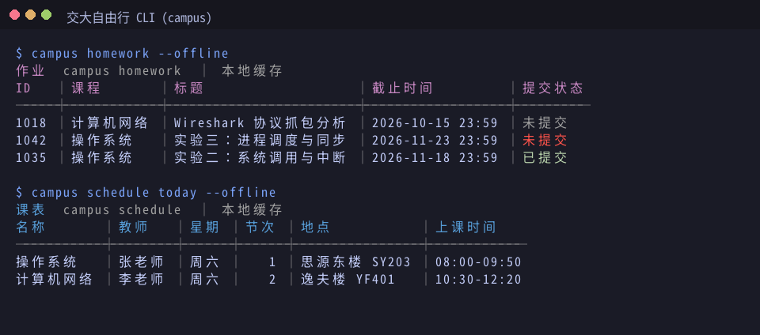

# 交大自由行 CLI (`campus`)

<p align="center">
  
</p>

> **北京交通大学非官方跨平台校园服务终端与全屏工作台** —— 基于 Rust + SQLite 构建，单文件绿色运行（Linux 静态二进制 `< 10 MiB`），打开即可查课表、追作业、算 GPA、查空教室、看校历、下课件并提交作业。  
> 账号密码、SM2 加密与离线缓存全部**在本地完成**，不上传至任何第三方服务器。

---

## 三分钟上手（普通用户安装教程）

前往 **[Releases 下载页面](https://github.com/Tak1naa/BJTUselfService-KMP-Refreshed-linux/releases)** 下载对应系统的安装包：

### 1. Windows 10 / 11（免安装绿色压缩包）
1. 下载 **`campus-bjtu-0.1.12-windows-x64.zip`** 并解压到固定文件夹（例如 `D:\Tools\campus`）。
2. **直接双击 `campus.exe`**（若弹出「Windows 已保护你的电脑」，点击 **「更多信息」 -> 「仍要运行」**）。
3. 首次打开会自动弹出登录向导：输入学号和 MIS 密码（密码输入时不显示字符属正常保护） -> 选择 **`Y`** 自动在桌面创建「交大自由行 CLI」快捷方式 -> **自动同步所有页面数据**并进入全屏工作台。以后双击桌面快捷方式即可秒开。

### 2. macOS（Apple Silicon M 系列 / Intel）
1. 下载 **`campus-bjtu-0.1.12-macos-universal.tar.gz`** 并解压，在终端运行：
   ```sh
   xattr -d com.apple.quarantine ./campus
   sudo install -m 755 ./campus /usr/local/bin/campus
   campus
   ```
2. 首次保存或读取凭据时，在钥匙串授权弹窗点击 **「始终允许」** 即可。

### 3. Linux（Ubuntu / Debian / Fedora / 通用发行版）
- **Ubuntu / Debian / Linux Mint**：`sudo apt install ./campus-bjtu_0.1.12_amd64.deb`
- **Fedora / RHEL / AlmaLinux**：`sudo dnf install ./campus-bjtu-0.1.12-1.*.x86_64.rpm`
- **任意 Linux / WSL**：解压 `campus-bjtu-0.1.12-linux-x86_64.tar.gz` 后执行 `install -Dm755 ./campus ~/.local/bin/campus`
- 若运行在无桌面钥匙串的纯 SSH / 服务器环境，首次登录前先执行 `campus config set vault.backend file`。

<p align="center">
  
</p>

---

## 核心功能

- **全屏工作台 (TUI)**：直接运行 `campus` 进入 10 个标签页工作台（课表列表与周网格、作业、成绩与 GPA、考试、五色教室周占用、一卡通、学年历、课件、同步状态、物理在线），毫秒级秒开本地缓存，按 `r` 后台同步，按 `l` 交互登录。
- **作业管理与上传提交**：未提交作业自动置顶并按截止时间排序，已过截止时间的未提交项以灰色弱化提示；全屏工作台选中作业按 `d` 下载老师附件至 `./homework`，按 `u` 支持拖入多个文件及说明并覆盖提交作业；也支持命令行 `campus homework show <ID> --refresh`、`campus homework download <ID> [--submitted]`、`campus homework submit <ID> --file 报告.pdf`。
- **课表与手机日历导出**：支持 `campus schedule today --offline` 查看当日课表与错峰时间，支持 `campus export ics -o bjtu.ics --offline` 一键导入手机或电脑日历。
- **成绩查询与 GPA 试算**：`campus grades gpa --offline` 自动计算学分加权均分与 4.0 制 GPA，支持按学期和课程性质筛选、自选课程试算及 CSV 导出。
- **教室占用与人数估计**：在全屏工作台按 `b` / `B` 切换教学楼、`+` / `-` 切换周次查看五色周占用网格，命令行支持空闲教室与实时人数检索。
- **课件下载与物理在线**：全屏工作台按 `d` 下载老师已开放的课件或实验附件（部分课件显示「不可下载」是因为老师在教务平台设为仅在线查看，`stu_download != "2"`）；物理在线支持独立账号、实验报告草稿上传增删与最终提交。
- **后台定时自动同步**：支持按 30m 至 168h 周期注册用户级定时同步（Linux `systemd --user` / macOS `launchd`），成绩或考试发生变更时支持桌面通知提醒。

更多命令、TUI 快捷键与常见问题见 **[CLI 完整使用手册 (`linux/README.md`)](linux/README.md)**；参与开发、运行测试与提交 PR 请看 **[贡献指南 (`CONTRIBUTING.md`)](CONTRIBUTING.md)**，公开维护计划与已知问题跟踪见 **[GitHub Issues](https://github.com/Tak1naa/BJTUselfService-KMP-Refreshed-linux/issues)**。

---

## 隐私、安全与数据清理

- **全链路本地处理**：SSO 页面解析、SM2 密码加密、图形验证码展示与输入均在本地完成，账号密码与会话 Cookie 仅保存在当前设备。
- **系统级凭据保护**：优先通过系统钥匙串（Linux Secret Service / macOS Keychain / Windows Credential Manager）保存密码与加密密钥，离线缓存默认采用系统密钥保护；无桌面环境可通过 `campus config set vault.backend file` 或 `passphrase` 显式选择加密方案。
- **安全卸载与数据清理**：
  - 注销并抹除凭据：`campus auth logout --forget`、`campus phyvlab logout --forget`
  - 仅清除离线缓存：`campus cache clear --yes`
  - 手动移除本地数据目录：Linux/macOS 为 `~/.local/share/campus-portal`、`~/.config/campus-portal`、`~/.cache/campus-portal`；Windows 为 `%LOCALAPPDATA%\campus-portal`。

---

## 从源码构建

核心源码位于 `linux/` 目录，分为 `campus-core`、`campus-db`、`campus-net`、`campus-sync`、`campus-cli` 五层 Crate：

```sh
cd linux
cargo test --locked --workspace
cargo build --locked --release -p campus-cli
```

完整构建、静态 musl 打包、基准检查与跨平台发包命令请参阅 **[贡献指南 (`CONTRIBUTING.md`)](CONTRIBUTING.md)** 与 **[架构文档 (`linux/docs/DEVELOPMENT.md`)](linux/docs/DEVELOPMENT.md)**。

---

## 致谢

本项目基于北京交通大学校园自助服务开源社区先驱工作与协议实践重构实现，感谢 [HFDLYS/BJTUselfService](https://github.com/HFDLYS/BJTUselfService)、[BJTUselfServiceAIO](https://github.com/optsimauth/BJTUselfServiceAIO) 及 [BJTUselfService-KMP-Refreshed](https://github.com/JasonZhang1225/BJTUselfService-KMP-Refreshed) 各位贡献者对校园接口解析与功能设计的探索。
